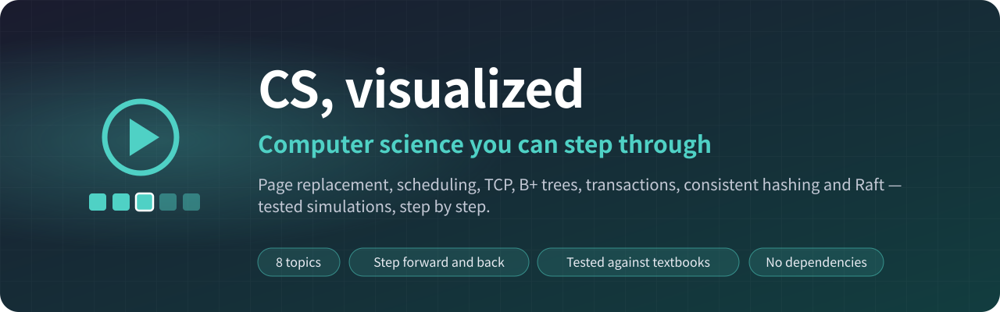

<div align="center">



<p>
<a href="https://github.com/zch6a/cs-visualized/actions/workflows/ci.yml"></a>
<a href="https://zch6a.github.io/cs-visualized/"></a>


<a href="LICENSE"></a>
</p>

**English** · [简体中文](README.zh-CN.md)

Interactive simulations of the ideas every engineer is taught and few have watched happen.
Step forward and back, change the input, and see exactly where the textbook answer comes from.

**[Open the live demo →](https://zch6a.github.io/cs-visualized/)**

</div>

---

Every simulation is plain TypeScript with no DOM, tested against the numbers textbooks print (FIFO 15,
LRU 12, OPT 9 faults on Silberschatz's reference string) and against the properties that must hold
(OPT is never beaten; LRU never faults more with more memory; FIFO sometimes does).

## Topics

| Area | Topic |
|---|---|
| Operating systems | **Page replacement** — FIFO, LRU, OPT, Clock, Bélády's anomaly |
| Operating systems | **CPU scheduling** — FCFS, SJF, SRTF, round robin, MLFQ with boost |
| Networking | **TCP congestion control** — slow start, AIMD, Tahoe vs Reno, why AIMD is fair |
| Networking | **Reliable delivery** — handshake, sliding window, Go-Back-N, Selective Repeat, fast retransmit |
| Databases | **B+ tree** — insert with splits, search, range scans along the leaf links |
| Databases | **Transaction isolation** — dirty reads, lost updates, write skew at four levels, with a serializability check |
| Distributed systems | **Consistent hashing** — the ring, virtual nodes, keys moved vs `hash mod N` |
| Distributed systems | **Raft** — elections, replication, commitment through crashes and partitions |

## What each page shows

Every number here is pinned by a test. Most are exactly what the page shows by default or on a preset; where the test uses a larger setup, it says so.

- **Page replacement** — on Silberschatz's reference string with 3 frames: FIFO 15 faults, LRU 12, OPT 9. And Bélády's anomaly: FIFO goes from 9 faults with 3 frames to 10 with 4.
- **CPU scheduling** — the convoy effect: the same three jobs average 17 ticks of waiting in arrival order, 3 if the long one goes last. SRTF has the lowest average wait on every one of 30 random workloads.
- **TCP congestion control** — Reno's sawtooth on a full link delivers about three quarters of its capacity over a long run (the page's shorter default, with a timeout in it, shows about two thirds); two AIMD flows halve the gap between them at every loss until they share equally.
- **Reliable delivery** — one lost segment: Go-Back-N resends four segments, Selective Repeat one, and TCP one, sooner, after three duplicate ACKs.
- **B+ tree** — every invariant (sorted nodes, fill limits, all leaves at one depth) holds after every single step, for orders 3–8 and any insertion order.
- **Transaction isolation** — a lost update at Read Committed (x ends at 11, not 12, and nobody is told); write skew passing snapshot isolation; Serializable aborting it.
- **Consistent hashing** — with 20,000 keys (the page draws 2,000), going from 5 servers to 6 moves about 1/6 of them on the ring, and 5/6 with `hash mod N`; with 200 points per server the busiest server stays under 1.1× the average load, with one point it is over 1.3×.
- **Raft** — a checker verifies the paper's safety properties on every tick of 60 random runs with crashes and partitions; a staged run of Figure 8 (with the no-op turned off) shows why only current-term entries are committed by counting, and new leaders commit through a no-op entry as in §8 of the paper.

## Run it

```bash
git clone https://github.com/zch6a/cs-visualized.git && cd cs-visualized
npm install          # TypeScript, for the build; the site itself has no dependencies
npm run dev          # build, serve on http://localhost:5173, rebuild on save
npm test             # the simulations' tests
npm run mutate       # test the tests: 40 deliberate bugs, each must make a test fail
```

Node 22.18 or newer (it runs the TypeScript scripts and tests directly). `npm run build` writes a static site to `dist/` — about 190 KB, no runtime dependencies — that any web server can host.

## How it is built

- `src/sim/` — the simulations: pure functions from an input to a list of steps, each step a full
  snapshot plus a sentence explaining it. No DOM, so they run under `node --test`.
- `src/topics/` — one page per topic: controls, a drawing of the current step, and things to try.
- `src/ui/` — a step player (back, forward, play, scrub; arrow keys, space, Home/End) and tiny DOM helpers.
- No framework and no bundler: `tsc` compiles to ES modules the browser loads directly.

## License

[MIT](LICENSE)
