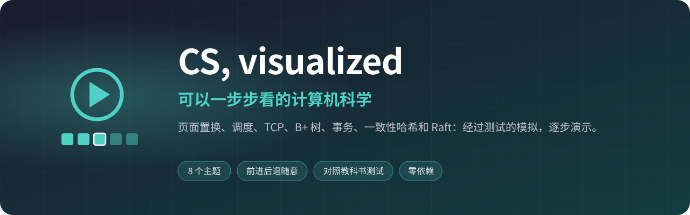

<div align="center">



<p>
<a href="https://github.com/zch6a/cs-visualized/actions/workflows/ci.yml"></a>
<a href="https://zch6a.github.io/cs-visualized/"></a>


<a href="LICENSE"></a>
</p>

[English](README.md) · **简体中文**

每个工程师都学过、却很少有人亲眼看着发生的那些概念，做成可以交互的模拟。
前进、后退、改输入，看清教科书上的答案究竟是怎么来的。

**[打开在线演示 →](https://zch6a.github.io/cs-visualized/)**（页面目前为英文）

</div>

---

每个模拟都是不依赖网页的纯 TypeScript，用教科书印着的数字来测试（Silberschatz 的经典访问序列：FIFO 缺页 15 次、LRU 12 次、OPT 9 次），也用必须成立的性质来测试（OPT 永远不会被超过；LRU 加内存永远不会多缺页；FIFO 有时会）。

## 主题

| 领域 | 主题 |
|---|---|
| 操作系统 | **页面置换**——FIFO、LRU、OPT、Clock，以及 Belady 异常 |
| 操作系统 | **CPU 调度**——FCFS、SJF、SRTF、时间片轮转、带优先级提升的多级反馈队列 |
| 网络 | **TCP 拥塞控制**——慢启动、AIMD、Tahoe 对比 Reno、AIMD 为什么公平 |
| 网络 | **可靠传输**——握手、滑动窗口、回退 N、选择重传、快速重传 |
| 数据库 | **B+ 树**——插入与分裂、查找、沿叶子链表的范围扫描 |
| 数据库 | **事务隔离**——四个隔离级别下的脏读、丢失更新、写偏斜，并检查结果是否可串行化 |
| 分布式系统 | **一致性哈希**——哈希环、虚拟节点、与 `hash mod N` 对比迁移的键数 |
| 分布式系统 | **Raft**——在崩溃和网络分区下的选主、复制与提交 |

## 每个页面能看到什么

下面每个数字都有测试固定住。大多数正是页面默认或预设场景下显示的结果。测试用了更大规模的地方会注明。

- **页面置换**——Silberschatz 的访问序列、3 个内存帧：FIFO 缺页 15 次，LRU 12 次，OPT 9 次。还有 Belady 异常：FIFO 从 3 帧的 9 次缺页变成 4 帧的 10 次。
- **CPU 调度**——护航效应：同样三个作业，按到达顺序平均等待 17 个时刻，长作业放最后则只有 3。在 30 组随机负载上，SRTF 的平均等待时间每次都最低。
- **TCP 拥塞控制**——链路跑满时，Reno 的锯齿形状在长时间运行中平均用掉约四分之三的容量（页面默认的运行较短、还含一次超时，约三分之二）。两条 AIMD 连接每次丢包都会把窗口差距减半，直到平分带宽。
- **可靠传输**——丢一个段：回退 N 重发 4 个，选择重传重发 1 个，TCP 也只重发 1 个，而且在三个重复 ACK 之后就重发，更早。
- **B+ 树**——在阶数 3–8、任意插入顺序下，每一步之后所有不变量（节点有序、填充上下限、所有叶子同一深度）都成立。
- **事务隔离**——读已提交下的丢失更新（x 最后是 11 而不是 12，而且没人被告知）；写偏斜能通过快照隔离；可串行化会中止它。
- **一致性哈希**——用 2 万个键测试（页面上画 2,000 个），从 5 台服务器变成 6 台，哈希环上约有 1/6 的键需要迁移，`hash mod N` 则是 5/6。每台 200 个虚拟节点时，最忙的服务器负载低于平均的 1.1 倍，每台 1 个点时超过 1.3 倍。
- **Raft**——一个检查器在 60 组带崩溃和分区的随机运行中，逐个时刻核对论文里的安全性质。一个按论文图 8 编排的测试场景（关掉 no-op）说明为什么只能通过计数提交本任期的条目。新领导者像论文第 8 节那样通过一条 no-op 条目来提交之前的日志。

## 运行

```bash
git clone https://github.com/zch6a/cs-visualized.git && cd cs-visualized
npm install          # 安装用于构建的 TypeScript；网站本身没有任何依赖
npm run dev          # 构建并在 http://localhost:5173 上预览，保存即重建
npm test             # 运行所有模拟的测试
npm run mutate       # 检验测试本身：逐个植入 40 个 bug，每个都必须让测试失败
```

需要 Node 22.18 或更新版本（直接运行 TypeScript 脚本和测试）。`npm run build` 会在 `dist/` 生成一个静态网站，约 190 KB、没有运行时依赖，任何 Web 服务器都能托管。

## 实现方式

- `src/sim/`——模拟本身：输入一组数据，输出每一步的完整快照加一句解释。不碰网页，所以能直接用 `node --test` 测试。
- `src/topics/`——每个主题一个页面：控件、当前这一步的图，以及可以动手试试的问题。
- `src/ui/`——步进播放器（后退、前进、播放、拖动；方向键、空格、Home/End）和几个很小的 DOM 辅助函数。
- 不用框架也不用打包工具：`tsc` 直接编译成浏览器能加载的 ES 模块。

## 许可证

[MIT](LICENSE)
